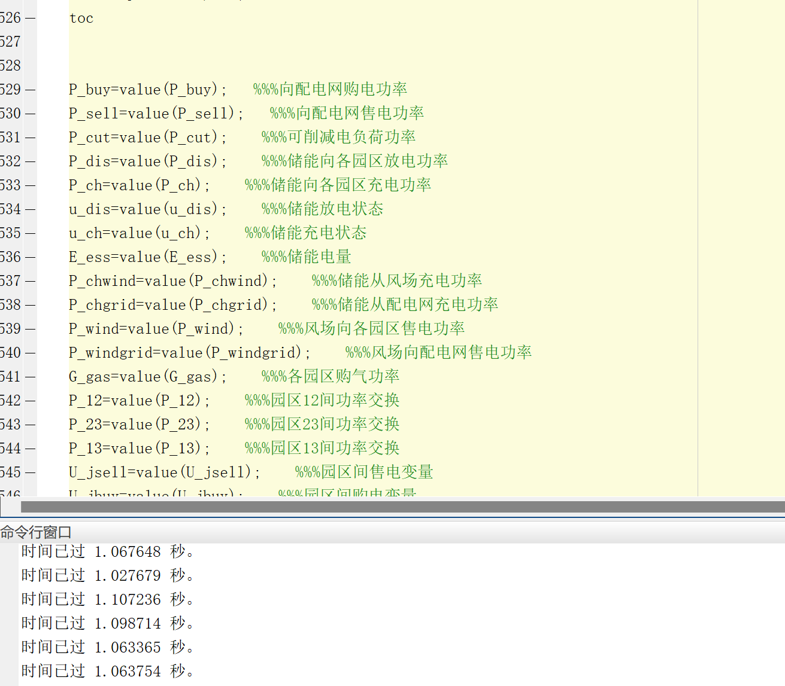

# Optimal scheduling strategy for multi-entity comprehensive energy system with consideration of demand response and power interaction based on master-slave game theory

Screenshot of the optimization dispatch strategy for a multi-subject comprehensive energy system that takes into account demand response and power interaction:
\n        \n

## Images

<!-- PAYMENT_BLOCK -->

## Get this dataset

- Payment link (Stripe): [Buy now](https://buy.stripe.com/3cs8yP7sY87d0vu9AB)
- Payment QR code: 

<!-- /PAYMENT_BLOCK -->
